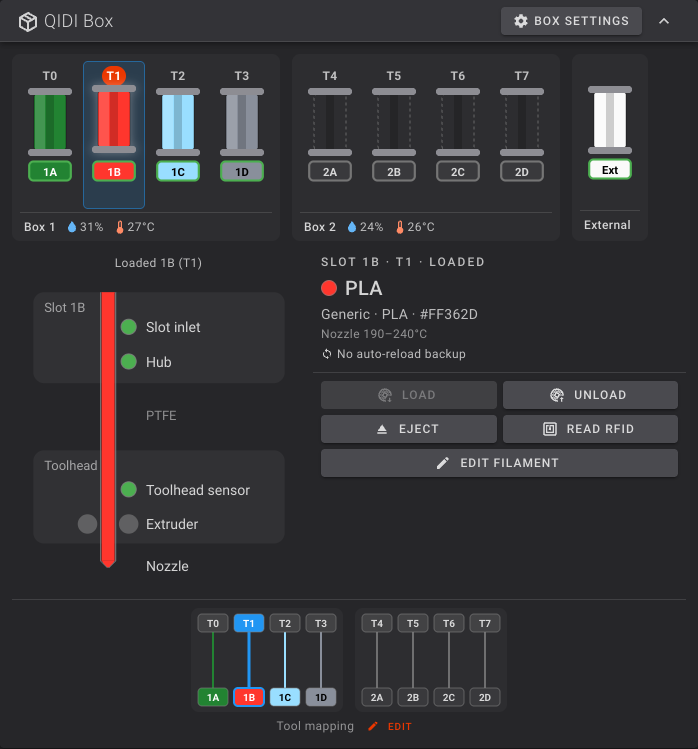

# Qidi Max 4 Optimized

Opinionated and Optimized Klipper macros and slicer machine GCode for the QIDI Max 4.

> [!NOTE]
> If you want to help support content like this, consider subscribing over on [YouTube](https://youtube.com/@TubaMakes)!

> [!CAUTION]
> I refuse to be responsible for your printer.  PLEASE watch prints start ensuring the printer doesn't do something horrible like gouge your bed and be ready to cut power at a moment's notice.

## tl;dr
1. SSH into your printer `qidi@<your printer's ip>`.
2. Run this on your printer:
```bash
/bin/bash -c "$(curl -fsSL https://github.com/thelegendtubaguy/Qidi-Max-4-Optimized/releases/latest/download/install-latest.sh)"
```
3. Follow the prompts
4. Use Orca and subscribe to the OrcaCloud bundle shared [here](https://cloud.orcaslicer.com/b/4c4b3b74c745).  If you're not using Orca >= 2.4.0, see [the section on slicer configs](#slicer-machine-gcode-updates).
5. Slice using the printer profile `Qidi X-Max 4 0.4 nozzle - TLTG Optimized GCode`
6. Optional: Make a copy and customize the machine profile to your liking.


### Installer Dry-Run
If you'd rather do a dry-run before committing to a full install, you can run this:

```bash
/bin/bash -c "$(curl -fsSL https://github.com/thelegendtubaguy/Qidi-Max-4-Optimized/releases/latest/download/install-latest.sh)" -- --dry-run
```

### Optional THR accelerometer firmware fix

On QIDI firmware `01.01.07.01`, the interactive installer asks early, before changing any configuration, whether to flash the THR toolhead board's LIS2DW FIFO bug fix. **The default is No**: press Enter to leave firmware unchanged. Answering yes flashes after the configuration install finishes. The installer checks the actual application and bootloader hashes; a board that already has the fix is verified without another reset or flash. **After flashing THR, rerun input shaper calibration before printing.** The installer clears the saved input shaper calibration from `printer.cfg`, so input shaping stays off until you recalibrate; the previous `printer.cfg` is kept with the THR recovery files. The installer does not run calibration.

Flashing requires an idle, ready printer with every heater target at zero. Keep printer power on until verification completes. The installer preserves stock recovery files under `~/printer_data/.tltg_thr_firmware_backups/`, flashes only THR, and verifies the complete application and unchanged bootloader before restoring services. If the bootloader is unsupported, THR firmware is left unchanged and previously active services are restored without a firmware blocker; the configuration install is kept. The installer saves a private read-only capture and identifies a shareable `report.json` to attach to a GitHub issue. Do not attach its flash binaries. See [THR-only operations](firmware/FLASHING.md) for admitted bootloader identities and recovery requirements.

`--yes` alone and automatic updates never authorize firmware programming. To opt in explicitly from the command line, use `~/tltg-optimized-macros/install.sh --flash-thr-fifo`; add `--dry-run` for a preview without serial access or service changes. Configuration restore and uninstall do not revert MCU firmware.

### Automatic Updates

The installer asks whether to enable hourly automatic optimized config updates before asking whether to restart Klipper. Auto-updates use a system-level systemd timer. Enabling auto-updates requires sudo once to install `/etc/systemd/system/tltg-optimized-auto-update.service` and `/etc/systemd/system/tltg-optimized-auto-update.timer`; the installer uses QIDI's public default sudo password (`qiditech`) unless the environment variable `TLTG_OPTIMIZED_SUDO_PASSWORD` is set, then prompts for a password if the initial sudo attempt fails.

If those systemd units already exist from a dev installer, a release install refreshes them to the current `~/tltg-optimized-macros` bundle, clears auto-update URL environment overrides, seeds the latest release checksum when GitHub is reachable, and re-enables/restarts the timer.

Each hourly run checks the latest GitHub release checksum, skips while the printer is printing or paused, and then runs the normal installer with preflight checks and auto-approval.

Disable auto-updates:

```bash
~/tltg-optimized-macros/auto-update.sh --disable-systemd
```

Run one auto-update check manually:

```bash
~/tltg-optimized-macros/auto-update.sh --run
```

### Moonraker 3MF metadata cache

Install and update patch recognized QIDI Moonraker source so unchanged 3MF files reuse their metadata instead of being re-extracted at every startup. This applies even when optional OS optimizations are skipped. Moonraker restarts when its file-manager patch changes; installation requires an idle printer.

The first restart rebuilds existing 3MF metadata once. Later scans still enumerate directories, but only new, changed, or invalidated archives need extraction. Changing the metadata extractor or object-processing policy invalidates the cache. This does not bypass print preparation or archive decompression needed by the printer itself.

Manual 3MF metadata rescans use the archive extractor and keep existing QIDI thumbnail files. A rescan joins extraction already pending for the same archive rather than starting another copy; failures report an error and preserve prior metadata. Ordinary G-code rescans are unchanged.

Unrecognized source is preserved and reported. Uninstall can restore the original source through its system-restoration prompt; files modified after installation are preserved.

### QIDI Box filaments in Fluidd

QIDI firmware `01.01.07.01` stores Box filaments with new IDs such as `QFA90`, colors as RGB values, and brands such as Bambu, HATCHBOX, Overture, and Polymaker through the filament itself. Its bundled Fluidd still expects the older numeric IDs: loaded slots show `?`, and filaments chosen in Fluidd are treated by the printer as QIDI PLA Basic.

Install and update patch QIDI's Fluidd, including when optional OS optimizations are skipped:

- Box slots show the filament, vendor, and color the printer is actually using. A slot set with an older numeric ID shows QIDI PLA Basic, because that is how `01.01.07.01` treats it; pick the filament again to fix it.
- The Vendor and Filament pickers match the touchscreen: choose a vendor, then one of its filaments. Changing the vendor switches to that vendor's filament of the same type when one exists.
- Colors chosen in Fluidd are saved the same way as on the touchscreen.
- The Box card's Load, Unload, and Eject buttons and RFID read send the commands `01.01.07.01` uses, and Unload is available when the selected slot is loaded.

Older supported firmware keeps Fluidd's original pickers and commands. After installing, close every Fluidd tab, then open Fluidd again; browsers that already had Fluidd open load the updated page on the next visit.

A Fluidd build the installer does not recognize is left unchanged. Uninstall can restore the original Fluidd through its system-restoration prompt; files modified after installation are preserved.

### Editing the QIDI filament list

On `01.01.07.01`, the touchscreen's Vendor and Filament lists come from QIDI's filament files. Install and update add a `qidi_filament_config` folder to Fluidd's configuration files that opens them, so you can add or adjust filaments from Fluidd:

- `filament-0.4.json` is the list for the 0.4 mm nozzle; the other files cover the other nozzle sizes. Right-click a file and choose Edit.
- To add a filament, copy an entry of the same material and give it a new name, a new unused `filament_id`, and the vendor to list it under. A new vendor name adds that vendor to the pickers.
- The file must stay valid JSON; a missing comma or bracket can break the touchscreen's filament list.
- Restart the printer after saving so the touchscreen and Box pick up the change, then reload Fluidd.

Firmware updates replace these files, so keep a copy of any entries you add. Files in this folder are QIDI's own files, not copies: they are not part of the installer's configuration backups, and deleting one in Fluidd deletes it from the printer. If `qidi_filament_config` already exists, the installer leaves it alone. Uninstall's system-restoration prompt removes the link but never your edits.

### QIDI Box temperature from Fluidd

Set a QIDI Box heater target from the `Heater Box1`/`Heater Box2` rows in Fluidd's temperature panel. The highest target allowed is the lowest Box temperature limit among the filaments loaded in that Box; an empty Box allows up to 65 °C, the Box's advertised maximum. If a loaded filament does not allow Box heating, the target field is locked; a Box that is already heating can still be set to `0`.

### Fluidd full display

Install and update turn on QIDI's **Enable Full Display** setting in Fluidd by default. It shows the bed mesh card on the Tune page and adds sensors without a target temperature, such as the chamber thermal protection and electronics sensors, to the temperature panel and chart. Turning it off in Fluidd's settings is remembered across updates.

### QidiBox card in Fluidd (preview)

Install and update add a **QidiBox** card to Fluidd's dashboard, a preview of a redesigned Box card. The existing Box card stays as it is, so you can compare them and use either. Existing dashboards get the card at the bottom of the first column; drag it wherever you like in Fluidd's layout mode.



- Every Box's slots and the external spool are shown at once. Each spool shows its color and the tools mapped to it above, and the slot label below has a green border when filament is at the slot's inlet. The loaded slot's tool label is highlighted.
- Under each Box are its humidity, temperature, and heater target when heating.
- The filament path shows how far the selected slot's filament reaches, following the slot inlet, hub, and toolhead sensors. The hub and toolhead only light up for the slot whose filament is actually there.
- With **Automatic Reload** on in Box settings, slots that can stand in for each other when one runs out are outlined in their filament color and share a reload letter (↻ A, ↻ B, …) under their labels: Box slots with the same filament, vendor, and color, as the Box card's AUTO view groups them. The selected slot also lists its backups.
- Click a slot to select it, then **Load**, **Unload**, **Eject**, **Read RFID**, or **Edit filament**. These do the same as the Box card's buttons and pickers and are unavailable while printing.
- The tool mapping at the bottom shows which slot each tool loads, one diagram per Box. While the printer is idle, click a tool or **Edit** to change it; **Default** restores T0 → 1A, T1 → 1B, and so on. Fluidd's print dialog sets the mapping for the print it starts, and a normal print end restores the default.
- **Box settings** opens the same settings as the Box card's **Config**, including load/unload motion.

After installing, close every Fluidd tab and open Fluidd again. Feedback on the layout is welcome in GitHub issues.

### Printer screen in Fluidd

Install and update add a **Printer screen** card to Fluidd's dashboard that shows the printer's touchscreen live, so you can check or use it from another room. This applies even when optional OS optimizations are skipped. The card starts collapsed and the printer does no screen work until you expand it. It stops when you collapse it, leave the dashboard, or switch to another tab. Existing dashboards get the card at the bottom of the first column; drag it wherever you like in Fluidd's layout mode.


- The screen opens **view only**: clicking or tapping the image does nothing on the printer.
- Choose **View only** in the card's header and confirm to turn on control. Clicks, taps, and drags on the image then press the real touchscreen, including during a print. Collapsing the card turns control back off.
- **Full screen** fills your browser or phone screen with it.


The screen is only available to devices that can already use Fluidd: the printer checks every connection with Moonraker, and the screen service itself only listens on the printer. After installing, close every Fluidd tab and open Fluidd again to load the new card.

Behind the card, the installer adds a small `tltg-remote-screen` service, and a `/tltg-screen/` route to QIDI's Fluidd web server configuration. The service sends a new image only when the screen changes. An nginx configuration the installer does not recognize is left unchanged, and the card then says the screen is unavailable. Uninstall can remove the service and restore the original web server configuration through its system-restoration prompt; files modified after installation are preserved.

### Klipper shutdown reasons

When Klipper stops on an error, such as a heater or fan fault or a lost Box connection, QIDI's print status module could crash Klipper during the shutdown, so the screen, Fluidd, and slicers showed only `MCU shutdown`. Install and update patch QIDI's `print_stats_manager.py` so the original reason stays on screen; `FIRMWARE_RESTART` recovers as usual. This applies even when optional OS optimizations are skipped, and Klipper restarts once when the patch is applied. Unrecognized source is preserved and reported. Uninstall can restore the original file through its system-restoration prompt; files modified after installation are preserved.

### Box MCU link monitoring

A Box that drops off its USB link shows up as `Lost communication with MCU 'mcu_boxN'` with no shutdown reason, so the cause is not recorded anywhere by default. The installer adds a monitor that is **off by default**. Enable it from Fluidd's console:

```gcode
SAVE_VARIABLE VARIABLE=tltg_box_link_monitor VALUE=1
```

While it is enabled, it writes `printer_data/logs/tltg_box_link.log`, separate from `klippy.log` so it survives log rotation. It records Box MCU serial counters and any change to them, box heater and print context, the reset reason each Box MCU reports at connect, and the first `Got EOF when reading from device`, `Timeout with MCU`, or `shutdown:` line that appears in `klippy.log`. Kernel USB lines are captured at that point too.

Set the variable back to `0` to stop recording; it takes effect without a restart. The log is capped at 2 MB and rotates once to `tltg_box_link.log.1`.

When reporting a Box MCU disconnect, include this file alongside the end of `klippy.log`.

### QIDI Box load and unload speed

You can tune how the Box pushes filament to the toolhead and pulls it back. A load pushes fast for most of the way, then approaches slowly until the toolhead filament sensor trips. Installing or updating saves the package defaults below unless you've already saved any of these settings, in which case all of yours are kept. Set them in Fluidd's Box card under **Config** → **Load/unload motion**, or with `TLTG_BOX_MOTION` in the console. Run `TLTG_BOX_MOTION` with no parameters to see the current settings and each slot's profile. After installing, close every Fluidd tab and open Fluidd again to load the new Box card.

| Parameter | What it sets | Package default | QIDI value | Allowed |
|---|---|---|---|---|
| `FAST_LENGTH` | How far the fast push goes, in mm | 950 | 930 | 100–2000 |
| `FAST_SPEED_1` | Speed of the first fast stage, in mm/s | 120 | 85 | 10–150 |
| `FAST_SPEED_2` | Speed of the second fast stage, in mm/s | 100 | 65 | 10–150 |
| `APPROACH_SPEED` | Speed for the rest of the way to the toolhead sensor, in mm/s | 15 | 10 | 2–40, below both fast speeds |
| `LOAD_ACCEL` | Load acceleration | QIDI's | 100 | 20–400 |
| `UNLOAD_SPEED_1`, `UNLOAD_SPEED_2` | Speeds of the two unload stages, in mm/s | 115, 120 | 65, 85 | 10–150, must differ |
| `UNLOAD_ACCEL` | Unload acceleration | QIDI's | 100 | 20–400 |
| `UNLOAD_EXTRUDER_LENGTH` | How far the extruder pulls filament back before the Box takes over, in mm. All slots only. | 50 | 120 | 20–300 |

```gcode
TLTG_BOX_MOTION FAST_SPEED_1=100 FAST_SPEED_2=100 APPROACH_SPEED=20
```

The command refuses a combination the Box can't run and says why. Settings take effect on the next load or unload, without a restart. Use `PARAM=vendor` to put one setting back to QIDI's value, or `TLTG_BOX_MOTION RESET=1` to go back to QIDI's motion everywhere, including slot settings. Updates don't reapply the package defaults after that.

Any setting can also be set for a single slot, which takes priority over the setting for all slots. For example, to load slot 2 more gently:

```gcode
TLTG_BOX_MOTION SLOT=2 FAST_SPEED_1=60 FAST_SPEED_2=60 APPROACH_SPEED=8
```

Slots are numbered from 0 the same way as `LOAD_FILAMENT_CONTROL SLOT=`, so the Box card's 1A is slot 0 and 2A is slot 4. Use `SLOT=2 FAST_SPEED_1=global` to make slot 2 follow the all-slots setting again, or `SLOT=2 RESET=1` to clear all of slot 2's settings.

`FAST_LENGTH` is used exactly as set. On the test printer, filament reached the toolhead sensor 1001–1016 mm into the push, so QIDI's 930 mm leaves about 70–85 mm for the slow approach. Set it past the sensor and the filament reaches the toolhead at full fast speed.

An unload starts with the extruder pulling the cut filament back 30 mm, then `UNLOAD_EXTRUDER_LENGTH` more at 10 mm/s, before the Box retracts at your unload speeds. On the test printer the filament left the toolhead sensor 34 mm into the unload, only about 4 mm into this second retract, so most of QIDI's 120 mm is the Box pulling free filament at 10 mm/s. The sensor sits above the extruder gears, so once it clears, the filament is out of the gears. A value of 20–30 mm keeps a margin past the sensor and saves about 9 seconds per unload.

If you saved one of the settings with an invalid value using `SAVE_VARIABLE`, the affected load or unload goes back to QIDI's motion and the console says why. If a QIDI firmware update changes how the Box moves filament in a way the settings don't recognize, the Box keeps QIDI's motion and the console says so.

### QIDI Box eject

QIDI's eject parks the toolhead over the waste chute before and after the Box pulls the filament back, so an eject homes X and Y on a printer that isn't homed. When the eject only needs the Box to pull filament back, the toolhead now stays where it is. That's when nothing is fed past the Box hub, or when another slot's filament is the one loaded. An eject that first has to heat and unload filament from the path to the toolhead still parks the way QIDI does. Either way the eject turns the hotend off and disables the extruder motor afterwards.

### Helpful Klipper tools

After install and Klipper restart, the optimized macro set includes:

```gcode
TLTG_TEST_PROBE CONFIRM=1
TLTG_PROBE_ACCURACY_CENTER
TLTG_CORNER_BED_SCREW_CHECK
SCREWS_TILT_CALCULATE
TLTG_RESET_TOOL_MAPPINGS
```

`TLTG_TEST_PROBE CONFIRM=1` checks that the nozzle load cell responds to light pressure. It does not move, home, heat, or change calibration. In Fluidd's macro controls, enter `1` in the `CONFIRM` field. The printer must be idle with all heaters off and the nozzle and bed below 40 °C. Make sure you can reach the nozzle and it is clear of the bed; **do not home to prepare for this test**.

Follow the console prompts. The test takes about 40 seconds:

1. Leave the nozzle alone through `DO NOT TOUCH` and `Measuring...`.
2. At `GET READY TO PRESS`, get ready. At `PRESS`, press lightly upward on the nozzle and hold.
3. When told to stop pressing, let go and leave the nozzle alone through `DO NOT TOUCH` and `Measuring...`.

The result is one of:

- `RESPONSE_DETECTED`: the readings look correct.
- `NO_RELIABLE_RESPONSE`: the sensor did not respond as expected.
- `INCONCLUSIVE`: there was not enough difference between pressing and not pressing to tell, or the test stopped early.

**A detected response does not verify the homing trigger or certify safe homing.** For any other result, do not press harder, and do not home or probe until the cause is understood. `QUERY_PROBE` cannot check this sensor. `TLTG_PROBE_ACCURACY_CENTER` and the screw check below both home, so they are not safe tests for a suspected failed sensor.

`TLTG_PROBE_ACCURACY_CENTER [SAMPLES=20]` homes, moves to `X195 Y195 Z10`, and runs Klipper `PROBE_ACCURACY`.

`TLTG_CORNER_BED_SCREW_CHECK` homes, runs `Z_TILT_ADJUST`, and runs `SCREWS_TILT_CALCULATE`.

`TLTG_RESET_TOOL_MAPPINGS` restores QIDI Box tool-to-slot identity mappings while the printer is idle. It is rejected while printing or paused.

### Print-start bed mesh

Each optimized print start calibrates a fresh adaptive KAMP mesh by default. To reuse an existing Klipper bed-mesh profile for every optimized start, save its exact name from the Klipper console:

```gcode
SAVE_VARIABLE VARIABLE=tltg_start_bed_mesh_profile VALUE='"default"'
```

Restore fresh adaptive calibration by saving an empty value:

```gcode
SAVE_VARIABLE VARIABLE=tltg_start_bed_mesh_profile VALUE='""'
```

The setting applies to existing sliced files and requires no change to slicer gcode. The console reports whether start preparation is loading the named profile or calibrating a fresh adaptive mesh. A configured profile must already exist; Klipper stops print preparation if it cannot load the name.

### Minimum chamber temperature

With OrcaSlicer 2.4.2 or later, use the updated `orcaslicer_gcode/start.gcode` and set the filament profile's chamber **Target** and **Minimal** temperatures. For example, Target `60°C` and Minimal `50°C` allow leveling and printing once the chamber reaches `50°C`, while heating continues toward `60°C`. The initial tool's filament supplies the minimum; values above the target are capped at the target.

Minimal `0` keeps the existing target-minus-3°C wait. Older start G-code and QIDI Studio retain that behavior with updated macros; updated Orca start G-code also works with older optimized macros, which ignore the minimum and retain their existing wait. Both the start G-code and optimized macros must be updated to use the shorter wait.

The minimum also applies to the chamber stage of staggered heating. A lower minimum allows nozzle heating to begin while the chamber is still heating toward its target.

### Staggered print-start heating

Staggered heating is disabled by default. Enable bed, chamber, then nozzle warm-up with a 10-second dwell between active stages:

```gcode
SAVE_VARIABLE VARIABLE=tltg_staggered_start_heating VALUE=1
SAVE_VARIABLE VARIABLE=tltg_staggered_start_heating_dwell_seconds VALUE=10
```

Set the dwell to another non-negative number of seconds, or use `0` to retain ordered heating without fixed dwell time. To disable staggered heating:

```gcode
SAVE_VARIABLE VARIABLE=tltg_staggered_start_heating VALUE=0
```

You will need to slice files with the latest slicer gcode from this repo (or Orca cloud).

### End-of-print filament handling

The installer sets `tltg_keep_loaded_between_prints` to `1` if the setting does not already exist. That makes filament retention the default after installation.

- `1`: Keep the current QIDI Box filament loaded after a completed print.
- `0` or not set: Cut and unload the filament after a completed print.

To disable filament retention and use the stock-style cut-and-unload behavior:

```gcode
SAVE_VARIABLE VARIABLE=tltg_keep_loaded_between_prints VALUE=0
```

To turn filament retention back on:

```gcode
SAVE_VARIABLE VARIABLE=tltg_keep_loaded_between_prints VALUE=1
```

The installer preserves an existing setting during updates. The setting survives Klipper restarts, works with existing sliced files, and does not require any slicer G-code changes.

### Filament runout sensor

```gcode
TLTG_FILAMENT_SENSOR ENABLE=0
TLTG_FILAMENT_SENSOR ENABLE=1
```

`ENABLE=0` keeps toolhead filament-sensor events and external-spool runout status reporting active while suppressing automatic external-spool pausing. `ENABLE=1` restores automatic external-spool pausing. The setting resets enabled after a Klipper restart. QIDI Box runout handling remains enabled in both modes.

> [!WARNING]
> With `ENABLE=0`, ignore filament-runout warnings on the printer screen. Do not interact with those warnings; the print continues and the warning remains only as sensor-event status.

The console identifies the toolhead sensor trip and the active pause policy.


### Slicer Machine GCode Updates

> [!TIP]
> If you're using Orca >= 2.4.0, use the OrcaCloud [shared bundle you can subscribe to](https://cloud.orcaslicer.com/b/4c4b3b74c745)!  It will let you get future updates in your slicer easily and you don't have to manually copy/paste anything!

You will need to manually copy the machine GCode to your slicer of choice to take advantage of the optimized path.  The stock print path remains in place for backwards compatibility, safety, and general user happiness :)

Use the pack that matches your slicer. The two packs are functionally aligned, but their placeholder syntax differs because of variable type differences.
   - OrcaSlicer: `orcaslicer_gcode/`
   - QIDI Studio: `qidistudio_gcode/`

## Uninstall

If `~/tltg-optimized-macros/` is still present on the printer:

```bash
~/tltg-optimized-macros/install.sh --uninstall --plain
```

You can also run uninstall by fetching the latest script directly from the web:

```bash
/bin/bash -c "$(curl -fsSL https://github.com/thelegendtubaguy/Qidi-Max-4-Optimized/releases/latest/download/install-latest.sh)" -- --uninstall
```

## If something goes wrong

Read the installer output first. The installer stops before writing when firmware detection, preflight, printer state, or free-space checks fail.

If Klipper is stopped with an error, such as `... is not a valid config section`, you can still run the installer. It installs its files first, restarts Klipper, and then updates saved settings. If Klipper still doesn't start, the installer says so; fix the error shown in Fluidd and run the installer again.

Installer-created backup `.zip` files are stored under `/home/qidi/printer_data/` with `tltg-optimized-macros-before-optimize-...zip` and `tltg-optimized-macros-before-uninstall-...zip` labels.

You can restore interactively when SSH'd into the printer.

```bash
cd ~/tltg-optimized-macros && ./restore.sh
```

Restore a specific backup:

```bash
cd ~/tltg-optimized-macros && ./restore.sh --backup /home/qidi/printer_data/<backup-name>.zip
```

If restore completed and the recovery sentinel is still present, clear it with:

```bash
cd ~/tltg-optimized-macros && ./install.sh --clear-recovery-sentinel
```

## Testing

See [TESTING](TESTING.md) to help validate releases.

## Development

For development documentation, see [DEVELOPMENT](DEVELOPMENT.md).

## License

Repository-authored content is licensed under [GPLv3](LICENSE). Third-party components and license texts are listed in [THIRD_PARTY_NOTICES.md](THIRD_PARTY_NOTICES.md).
